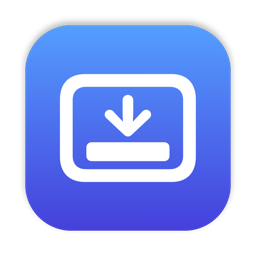

<p align="center">
  
</p>

<h1 align="center">Dock Minimize</h1>

<p align="center">
  Click the Dock icon of the app you're using to minimize it, just like the Windows taskbar.<br>
  Click it again to bring its windows back.
</p>

---

On macOS, clicking the Dock icon of the app that is already in front does nothing. Dock Minimize makes that click useful: it sends every window of the app to the Dock, and the next click restores all of them. It is a tiny menu bar app with no settings to learn.

## Install

1. Download the latest `DockMinimize-<version>.zip` from [Releases](../../releases/latest) and unzip it.
2. Move **Dock Minimize** to your Applications folder and open it.
3. When macOS asks, allow it under **System Settings > Privacy & Security > Accessibility**.

That's it. A Dock icon appears in the menu bar; it is dimmed while the app is switched off or still waiting for access.

Requires macOS 14 Sonoma or later. Runs natively on Apple silicon and Intel.

## Menu bar options

| Option | What it does |
| --- | --- |
| Enabled | Turns the click behavior on or off. |
| Minimizes its windows | The default. Every window goes to the Dock, and the next click brings them all back. |
| Hides it (no animation) | Hides the app like Cmd+H. Instant, if you prefer speed over the Windows feel. |
| Launch at Login | Starts Dock Minimize when you log in. |

Tip: for a snappier minimize, choose **Scale** as the minimize effect in **System Settings > Desktop & Dock**.

## How it works

Dock Minimize never gets between you and the Dock.

- **It only listens.** Clicks are observed through a listen-only event tap, which cannot block, delay or change input. Dragging icons, long-press menus and Cmd, Option, Control or Shift clicks behave exactly as before.
- **It asks the Dock, not the whole system.** When the mouse goes down, it asks the Dock process alone what is under the pointer. That takes well under a millisecond, while a system-wide lookup can stall for over a second when a busy app owns the point. A hidden Dock reports nothing, so auto-hide and full screen are handled for free.
- **It decides early and acts late.** The decision is made on mouse down, before the Dock reacts, using the app that was in front at that moment. The action runs on mouse up, and only for a short click that didn't move.
- **It stays out of the way.** If the app has no visible windows, the click is left alone so the Dock can reopen the app as usual.
- **It handles the Dock's reopen request.** On every click the Dock asks the app to reopen, and apps answer by restoring a minimized window. Dock Minimize lets that request land first and puts back anything it restored too late.

The code is small and commented: start with [`DockMinimizer.swift`](Sources/DockMinimizer.swift).

## Privacy

Dock Minimize has no network access and collects nothing. Accessibility access is used only to read the Dock's icons and to minimize, hide and restore windows of the app you clicked.

## Build from source

Requires Xcode 16 or later.

```bash
./build.sh            # build into build/, signed for this Mac
./build.sh install    # build, copy to /Applications and launch
./build.sh release    # universal build, Developer ID signing, notarization and a zip for sharing
```

`release` needs notarization credentials stored once:

```bash
xcrun notarytool store-credentials DockMinimize --apple-id you@example.com --team-id YOURTEAMID
```

Debug output is available through the unified log:

```bash
log stream --level debug --predicate 'subsystem == "com.kevinbrenden.DockMinimize"'
```

## License

[MIT](LICENSE) © Kevin Brenden
